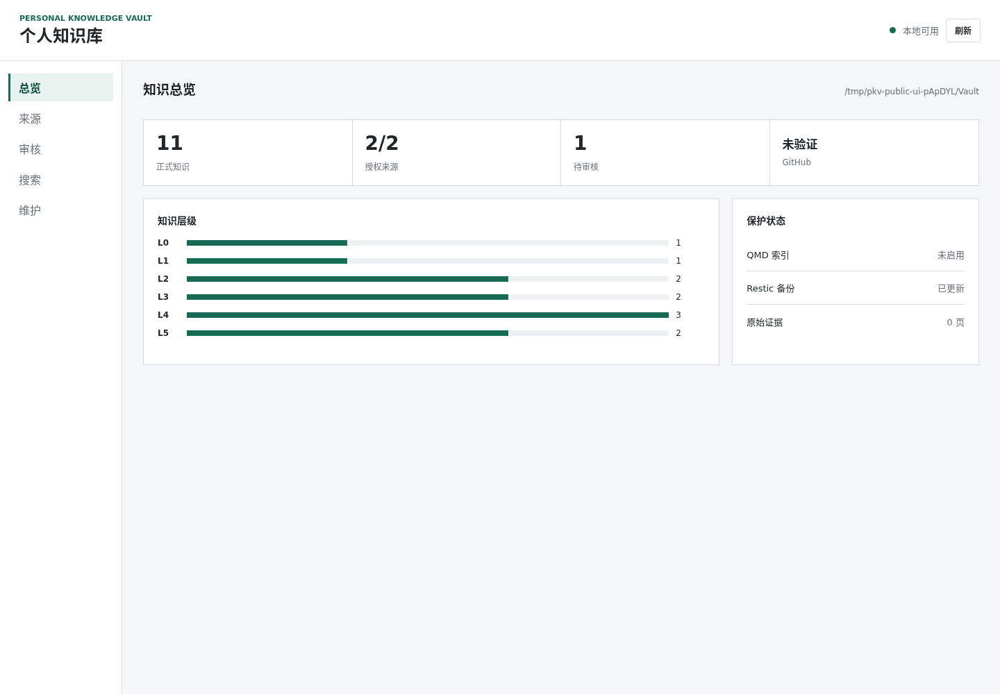

# Personal Knowledge Vault Skill

一个面向个人用户的开源 Codex/Claude Skill 与 Python runtime：在 **Linux 或原生 Windows** 上，把用户逐项授权的项目、学习资料、文档、AI 会话导出和自创 GitHub Skills，整理为私密、可读、可审计、可持续更新的 **Obsidian Markdown 知识库**。

它不是“扫描整台电脑后把一切交给 AI”的工具。默认不读取 Home、浏览器、凭据、微信/QQ 内部目录，也不要求 WSL 或本地大模型。

## 交付结果

- 带首页和 L0-L5 层次的 Obsidian Vault；全局只突出领域、主线和项目，来源证据保持可追溯但不占满主图。
- 项目、学习、文档和 Skills 的中文可读页面，保留本机路径和可用的 GitHub commit 固定链接。
- 仅监听 `127.0.0.1` 的中英双语管理控制台，包含总览、来源、审核、搜索和维护视图。
- 每日确定性更新，以及进入 `_staging`、必须人工批准的 AI 语义知识提案。
- 无额外依赖的内建全文搜索；可选 QMD 索引、Restic 加密备份和 GitHub `PRIVATE` 镜像。



## 安全边界

- 所有来源都先 `add`、后用精确确认串启用；聊天与 Agent 历史需要二次授权。
- Vault、Data、索引、备份和凭据必须位于本公共源码仓库之外。
- 不跟随来源根或内容中的未知符号链接，不收录 `.env`、token、私钥和凭据目录。
- `update` 只更新知识；它不会执行 runtime `upgrade`，也不会自动批准 `_staging`。
- GitHub 知识镜像只能是 `PRIVATE`；准备、push 前或 push 后无法证明私有时立即停止。

完整边界见 [威胁模型](docs/threat-model.md) 和 Skill 内的 [隐私规则](skills/build-personal-knowledge-vault/references/privacy-boundary.md)。

## 快速开始

### 使用发布版 Skill

从 [Releases](https://github.com/Frido0319/personal-knowledge-vault-skill/releases) 下载 `.skill` 与 `SHA256SUMS`，先校验哈希，再把 `.skill` 安装到支持的 Agent。调用：

```text
$build-personal-knowledge-vault 帮我在本机建立一个中文个人知识库，先只预览，不扫描未授权目录。
```

发布 `.skill` 内含同一 commit 构建且经哈希绑定的 runtime wheel。**源码 checkout 刻意不提交 wheel**；直接从源码运行安装器会以 `ONE_BUNDLED_RUNTIME_WHEEL_REQUIRED` 停止。开发者应先运行发布构建器。

### 从源码开发

```bash
python -m pip install -e '.[dev]'
pytest -q
python scripts/privacy_audit.py --root .
python scripts/build_release.py --output dist --allow-dirty
```

正式发布要求干净工作树，不使用 `--allow-dirty`。解开生成的 `.skill` 后：

```bash
python scripts/install_runtime.py --preview
python scripts/install_runtime.py --apply
python scripts/verify_install.py --target <runtime-venv>
```

若隔离环境缺少 PyYAML，安装器会停止；只有用户明确同意依赖联网后才加 `--allow-network`。

### 初始化与授权

```bash
personal-vault init --vault <vault-path> --data <data-path> --language zh-CN --dry-run
personal-vault init --vault <vault-path> --data <data-path> --language zh-CN
personal-vault source add --config <config> --id projects --kind project --path <exact-project-root>
personal-vault source enable --config <config> --id projects --confirmation ENABLE:projects
personal-vault update --config <config> --preview
personal-vault update --config <config> --apply
personal-vault serve --config <config> --host 127.0.0.1 --port 8766
```

Windows 使用同一 CLI 和本机 Python，调度使用当前用户 Task Scheduler；Linux 使用 systemd user timer。无需把 Windows 改造成 Ubuntu。

## 结构

```text
src/personal_vault/                  唯一 runtime 源码
skills/build-personal-knowledge-vault/  Skill、参考、安装器和配置模板
platform/linux/                      systemd user 模板
platform/windows/                    原生 PowerShell/Task Scheduler 模板
scripts/                             构建、安全与合成验收
tests/                               仅合成夹具
```

发布包包含：

- `personal_knowledge_vault-<version>-py3-none-any.whl`
- `build-personal-knowledge-vault-<version>.skill`
- `SHA256SUMS`

`.skill` 内嵌的 wheel 与外部 wheel 字节相同，并记录 source commit、固定构建时间和 SHA-256。

## 验证

- `pytest` 覆盖权限边界、幂等更新、人工审核、搜索、私有镜像、Web 安全、Linux/Windows 调度、Skill 契约和可复现构建。
- `scripts/synthetic_acceptance.py` 在临时目录执行完整离线产品闭环和合成恢复。
- GitHub Actions 在 `ubuntu-latest` 与 `windows-latest` 原生运行；Windows 不经过 WSL。
- UI 证据使用合成数据，并已实际检查桌面和移动视口。

运维步骤见 [operations.md](docs/operations.md)，设计决策见 [设计规格](docs/superpowers/specs/2026-11-04-personal-knowledge-vault-skill-design.md)。

## English

Personal Knowledge Vault is a local-first Skill and Python runtime for building a readable, privacy-bounded Obsidian vault from explicitly authorized sources. It supports Linux and native Windows, keeps semantic output in human-reviewed staging, and treats QMD, Restic, GitHub, and local models as optional integrations rather than core requirements.

## License

MIT
